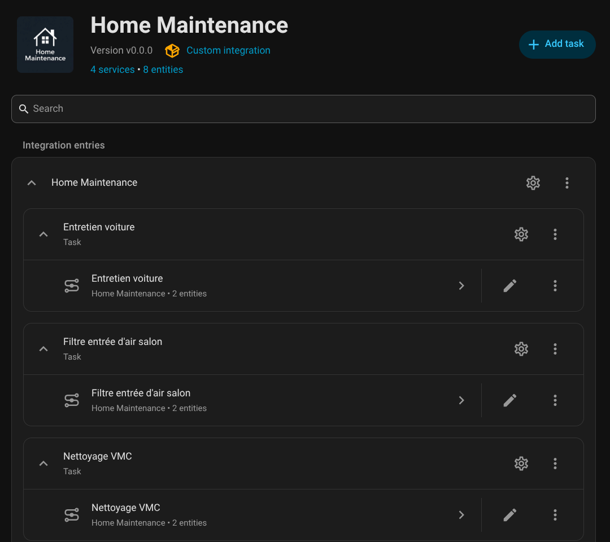
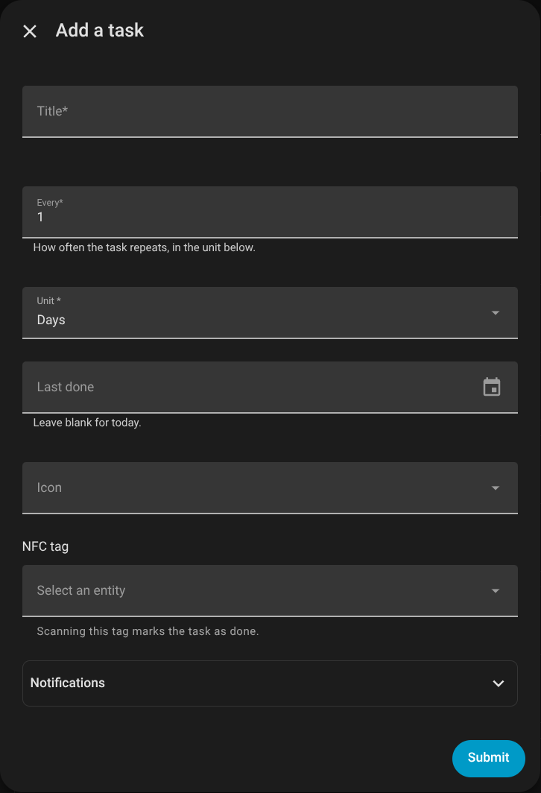
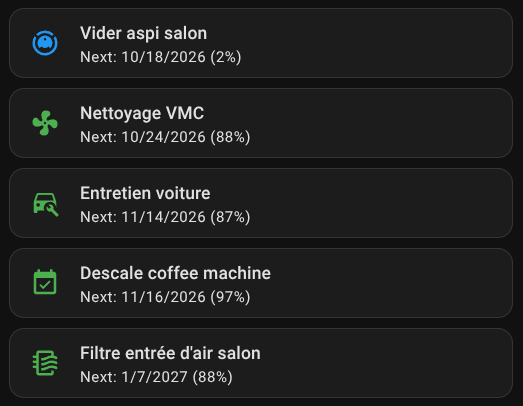

# 🏠 Home Maintenance Tracker for Home Assistant

Keep your home in top shape by tracking recurring maintenance tasks right inside Home Assistant!

This custom integration helps you remember important chores like changing air filters, cleaning gutters, or testing smoke alarms — and shows you when they're due.

> This is a maintained fork of [TJPoorman/home_maintenance](https://github.com/TJPoorman/home_maintenance), updated for current Home Assistant releases. It requires **Home Assistant 2026.9** or newer.

---

## ✨ What It Does

- 📋 Lets you create recurring tasks (e.g., “Change HVAC filter every 90 days”), right in the integration's settings
- 🔔 Gives each task a sensor that turns on when it's due, for automations and dashboards
- ✅ Lets you mark tasks as done with a button, a dashboard card, an action or an NFC tag
- 📱 Notifies your phones when tasks are due
- 🃏 Includes a dashboard card showing your tasks and how soon they're due

---

## ⚠️ Important Note
This integration was created to fill a simple but important gap in Home Assistant: the ability to create recurring tasks without relying on multiple helpers and automations. It is intentionally minimal by design — focused solely on task tracking.

Home Assistant already provides powerful features for dashboards, automations, and alerts, and this integration is meant to complement those, not replace them.

Because it's a custom component with limited scope and resources, not all feature requests will be added or considered — especially if the functionality already exists natively in Home Assistant or falls outside the intended purpose of the integration.

Thank you for understanding and helping keep this integration focused and maintainable.

---

## 🖼️ Screenshots

| Your tasks | Adding a task | Dashboard card |
|---|---|---|
|  |  |  |

---

## 🛠️ Installation

[](https://my.home-assistant.io/redirect/hacs_repository/?owner=damou8&repository=home_maintenance&category=Integration)

<details>
<summary>Click to show installation instructions</summary>
<ol>
<li>Install files:</li>
<ul>
<li><u>Using HACS:</u><br>
In the HACS panel, search for 'Home Maintenance', open the repository and click 'Download'.</li>
<li><u>Manually:</u><br>
Download the <a href="https://github.com/damou8/home_maintenance/releases">latest release</a> as a zip file and extract it into the `custom_components` folder in your HA installation.</li>
</ul>
<li>Restart HA to load the integration into HA.</li>
<li>Go to Settings -> Devices & services and click 'ADD INTEGRATION' button. Look for Home Maintenance and click to add it.</li>
<li>The Home Maintenance integration is ready for use: add your first task with <b>Add task</b> on its page.</li>
</ol>
</details>

---

## 🛠️ How to Use

Tasks live on the integration's page: **Settings → Devices & services → Home Maintenance**.

- **Add task** asks for:
  - a title (e.g. “Clean dryer vent”)
  - how often it repeats: a number and a unit (days, weeks or months)
  - when you last did it (optional, today by default)
  - an icon and an NFC tag (optional: scanning the tag marks the task done)
  - who to notify (optional, see [Notifications](#-notifications))
- A task's **⚙** button changes it. That's also where you **disable** a task: it then stays `off` and sends no notifications.
- A task's **⋮** menu deletes it.

Each task is a device with two entities:

- `binary_sensor.<task>`: `on` when the task is due. Its attributes give `last_performed`, `next_due`, `interval_value`, `interval_type` and `enabled`.
- `button.<task>_mark_done`: press it to mark the task done today.

You can also mark tasks done from the [dashboard card](#-dashboard-card), the [`reset_last_performed` action](#-available-actions) or the task's NFC tag. The integration is available in English, French and German.

### ⬆️ Upgrading from 1.x

Version 2.0 replaces the **Home Maintenance** sidebar panel with the integration's own settings pages, and moves your tasks there on the first start. Your entity IDs, history, labels and automations keep working. Two things change:

- Each task becomes its own device, and its sensor is named after the task alone (“Clean filter” instead of “Home Maintenance Clean filter”).
- The sidebar panel is gone. Its settings (admin only, sidebar title) no longer exist.

Make a backup before updating: going back to 1.x means restoring it.

---

## 🔔 Notifications

Home Maintenance can notify your phones when tasks are due, no automation needed.

1. Go to **Settings → Devices & services → Home Maintenance → Configure**.
2. Pick the default **notify** entities (e.g. your phones from the Companion app), the notification time, how many days before the due date to send a reminder (`0` = no reminder), and whether to repeat the notification every day while a task is overdue.
3. Each task has a **Notifications** section in its form:
   - **Default targets**: use the entities chosen in step 2
   - **Custom targets**: notify other entities for this task only
   - **No notifications**: never notify for this task

Messages are sent with `notify.send_message` in Home Assistant's language (English, French and German included).

---

## 🃏 Dashboard card

The integration ships a dashboard card, no extra resource to install. Edit a dashboard → **Add card** → **Home Maintenance**, or in YAML:

```yaml
type: custom:home-maintenance-card
```

It's the quickest way to see all your tasks at once. Each task shows its icon, name and next due date with the share of the interval left. The icon is **red** (and pulses) when the task is due, **blue** when less than 15% of the interval is left, **green** otherwise. Due tasks come first, then by due date. Tapping a task marks it done after a confirmation; holding it opens its details.

| Option | Default | Description |
|---|---|---|
| `title` | | Title above the tasks |
| `show_disabled` | `false` | Also show disabled tasks (greyed out, at the end) |
| `labels` | | Only show tasks with at least one of these label IDs |
| `warning_threshold` | `15` | Below this % of the interval left, the icon turns blue |
| `tap_action` | mark as done | Any [card action](https://www.home-assistant.io/dashboards/actions/); a `perform-action` without target applies to the tapped task |
| `hold_action` | `more-info` | Same as `tap_action` |

---

## 🔄 Example Tasks

| Task                 | Interval | Last Done     |
|----------------------|----------|---------------|
| Change HVAC Filter   | 90 days  | Jan 15, 2025  |
| Test Smoke Alarms    | 6 months | Dec 1, 2024   |
| Clean Gutters        | 8 weeks  | Oct 1, 2024   |

---

## 🔁 Available Actions

### `home_maintenance.reset_last_performed`

Marks one or more tasks as done, today or on the given date, which sets their next due date. Target a task's sensor or its Mark done button.

#### Example action:

```yaml
action: home_maintenance.reset_last_performed
target:
  entity_id: binary_sensor.clean_gutters
data:
  performed_date: "2025-06-19"
```

### `home_maintenance.send_notifications`

Sends the due-task notifications right away, the same way the daily check does. Handy to test your setup.

```yaml
action: home_maintenance.send_notifications
```

---

## 💬 Need Help?

[Open an issue](https://github.com/damou8/home_maintenance/issues) here on GitHub or ask in the Home Assistant community.

[Home Assistant Community Thread](https://community.home-assistant.io/t/new-integration-home-maintenance-track-recurring-tasks-in-home-assistant/897324)

---

## 🧑‍💻 Contributing

Pull requests are welcome. See [CONTRIBUTING.md](CONTRIBUTING.md) for the development setup, and [CLAUDE.md](CLAUDE.md) for the code layout and conventions.

---

## 📄 License

MIT License – free to use, share, and improve. Originally created by [@TJPoorman](https://github.com/TJPoorman).
